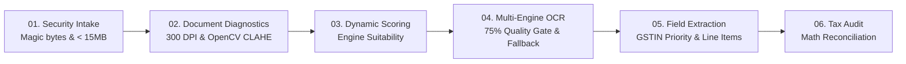

# ⚡ Invoice Elixir — Production Invoice OCR & Multi-Engine Processing

**Invoice Elixir** is an enterprise-grade OCR orchestration and invoice extraction platform built with **FastAPI** and **Python**. It features dynamic multi-engine routing, a multi-signal quality gate with automatic fallback, strict **Indian GSTIN Mod-36 checksum verification**, and a high-contrast side-by-side verification interface.

---

## 🏗️ 6-Stage Execution Pipeline



1. **Security Intake** ([`file_validator.py`](file:///e:/Invoice%20Elixir/app/security/file_validator.py)): Enforces strict `< 15 MB` size limit, magic byte validation (`%PDF-`, `\x89PNG`, `\xff\xd8\xff`), and UUIDv4 path isolation.
2. **Document Diagnostics** ([`pdf_analyzer.py`](file:///e:/Invoice%20Elixir/app/document/pdf_analyzer.py)): Renders 300 DPI targets, detects table grids, and deskews angles ($\le \pm 15^\circ$).
3. **Dynamic Scoring & Routing** ([`router.py`](file:///e:/Invoice%20Elixir/app/ocr/router.py)): Ranks active OCR engines based on document type (Digital vs. Scanned), noise, and table presence.
4. **Execution & Fallback Loop** ([`evaluator.py`](file:///e:/Invoice%20Elixir/app/ocr/evaluator.py)): Evaluates OCR output against a composite quality gate ($75\%$ threshold); auto-retries alternative engines on failure.
5. **GSTIN Priority Extraction** ([`invoice_extractor.py`](file:///e:/Invoice%20Elixir/app/extraction/invoice_extractor.py)): Validates 15-character Indian GSTIN via Mod-36 checksum; extracts parties, dates, totals, and tabular line items without inventing missing data.
6. **Financial Consistency & Audit** ([`invoice_validator.py`](file:///e:/Invoice%20Elixir/app/validation/invoice_validator.py)): Verifies $\text{Taxable} + \text{Taxes} + \text{RoundOff} \approx \text{Total}$ within 1% tolerance and outputs full audit history.

---

## 🎛️ OCR Engines Matrix

| Engine | Primary Strength | Digital Wt | Scanned Wt | Live Toggle |
| :--- | :--- | :---: | :---: | :---: |
| **PaddleOCR** | Scanned invoices, tables & multi-column grids | 85% | 95% | ✅ Supported |
| **Surya OCR** | Transformer layout analysis & complex reading orders | 88% | 92% | ✅ Supported |
| **Tesseract** | High-contrast standard text & vector PDFs | 90% | 75% | ✅ Supported |
| **docTR** | Deep field detection & structured forms | 85% | 85% | ✅ Supported |
| **EasyOCR** | Low lighting, noise resilience & rotated text | 80% | 80% | ✅ Supported |

---

## 🖥️ User Interface Highlights

- **🔤 Raw OCR Text Displayed First**: Direct character stream with one-click copy and character count.
- **📄 De-Overlapped Spatial Document Layout**: Clustered horizontal lines and column segments rendered at exact physical coordinates `(x1, y1, x2, y2)` on an A4 canvas.
- **🎯 Side-by-Side Field Breakdown**: 18+ evaluated fields grouped into GST, Parties, Metadata, and Amounts with individual confidence meters.
- **🧠 Engine Decision Banner**: Real-time explanation of why an OCR engine was selected and quality scores achieved.
- **🎛️ Orchestrator Control Hub**: Dedicated panel to toggle individual OCR engines ON/OFF, adjust acceptance thresholds, and simulate routing rules in real time.

---

## 📁 Project Structure

```
Invoice Elixir/
├── app/
│   ├── main.py                  # FastAPI app & static file mounts
│   ├── api/                     # REST API routes (upload, health, toggle, settings, simulate)
│   ├── security/                # File intake, MIME & magic byte verification
│   ├── document/                # PyMuPDF rendering & OpenCV preprocessing
│   ├── ocr/                     # Engine wrappers (Paddle, Surya, Tesseract, docTR, EasyOCR)
│   ├── extraction/              # GSTIN, dates, amounts, line items & regex registry
│   ├── validation/              # Mod-36 checksum & tax balance verification
│   ├── models/                  # Pydantic data schemas
│   └── services/                # Master pipeline orchestration service
├── frontend/                    # Modern Light-Theme UI (HTML5, CSS3, ES6+ JS)
│   ├── index.html
│   ├── styles.css
│   └── app.js
├── tests/                       # Automated PyTest test suites
├── config.py                    # System configuration & thresholds
└── requirements.txt             # Python dependencies
```

---

## 🚀 Quick Start

### 1. Run the Server
```powershell
python -m uvicorn app.main:app --host 127.0.0.1 --port 8000
```
Open **[http://127.0.0.1:8000/](http://127.0.0.1:8000/)** in your browser.

### 2. Run Test Suite
```powershell
python -m pytest tests/test_gstin.py tests/test_security.py tests/test_validation.py -v
```

---

## 📡 Key REST API Endpoints

- `POST /api/upload`: Upload invoice file (PDF/Image) for full 6-stage OCR and structured extraction.
- `GET /api/health`: Fetch system status, engine availability, and active configuration.
- `POST /api/engines/toggle`: Dynamically turn an OCR engine ON or OFF.
- `POST /api/settings/update`: Update quality gate threshold and max retry counts.
- `POST /api/orchestrator/simulate`: Test engine scoring logic against document properties.
